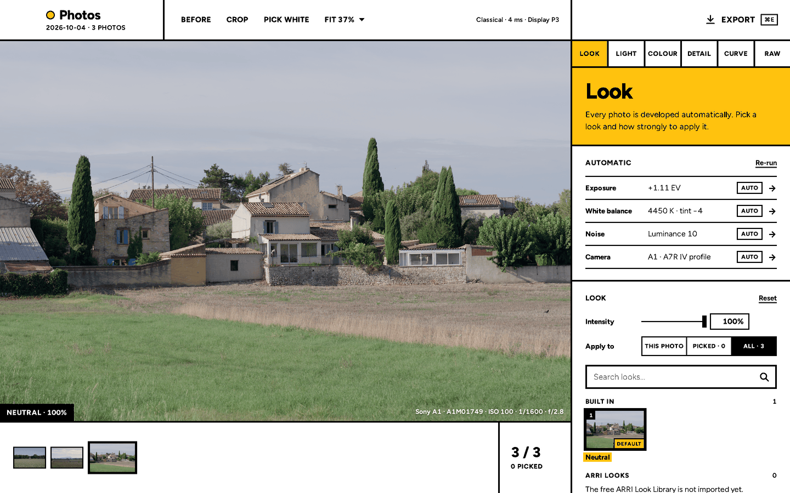
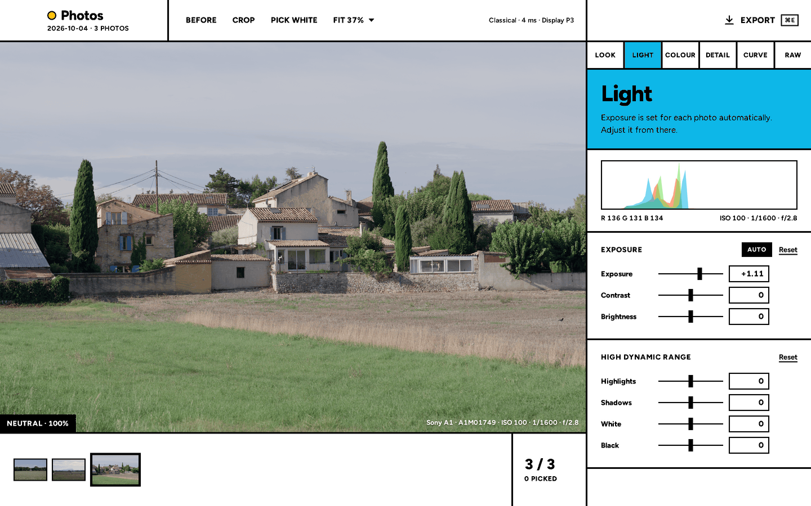
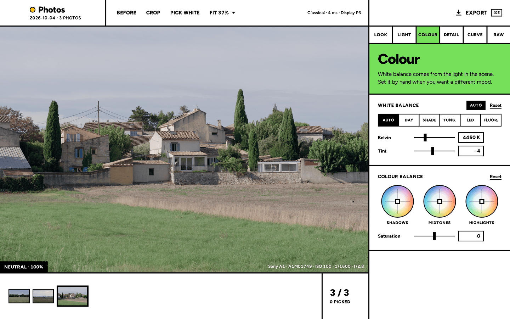
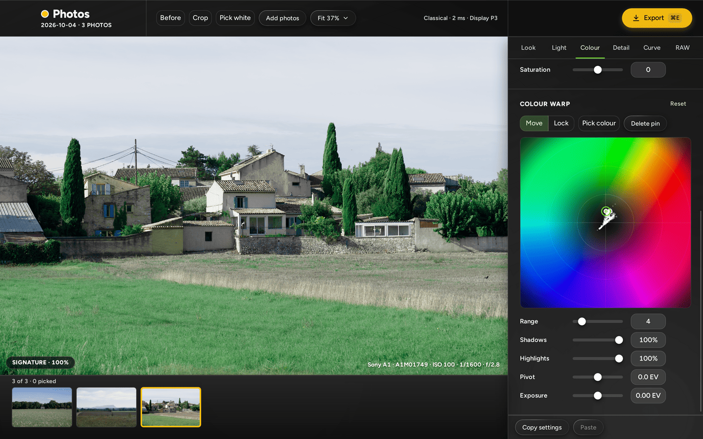
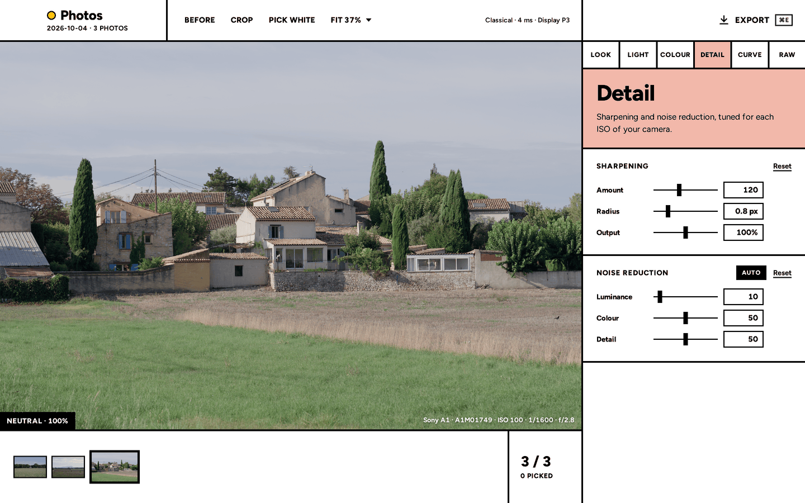
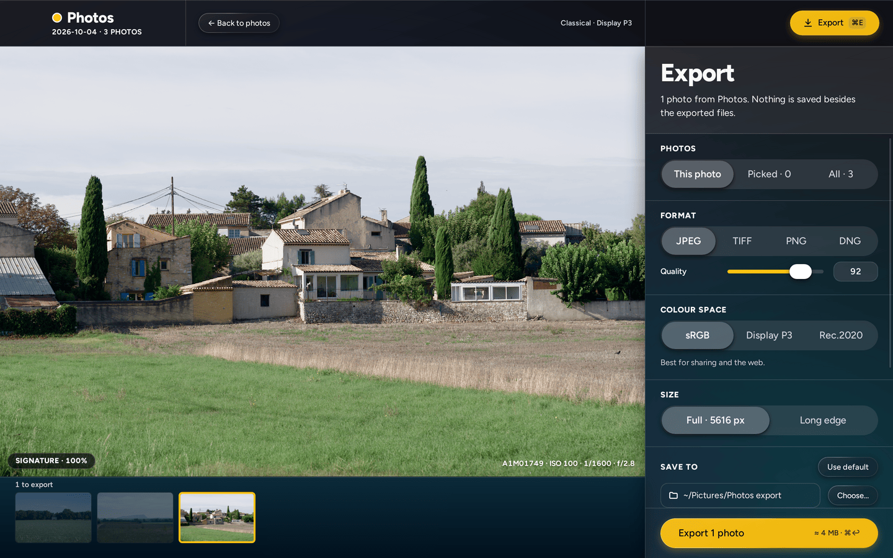
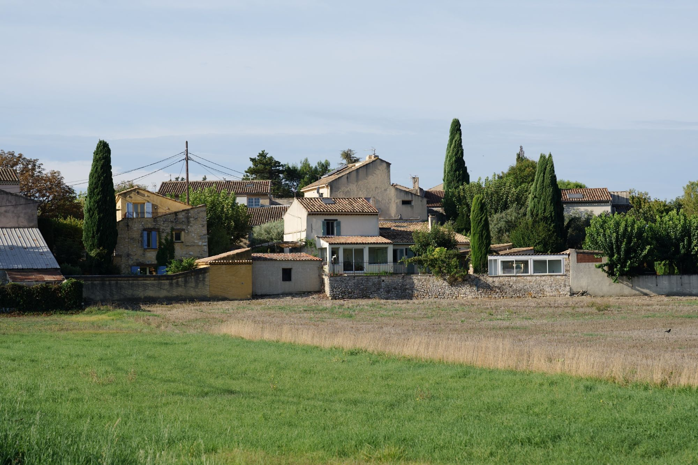
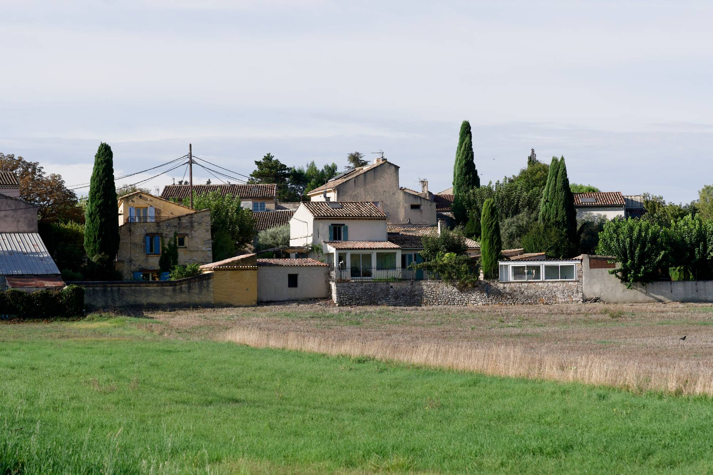

# Yellowmoon

**Cinema colour for Sony raw files.**

Yellowmoon is a free, open-source raw processor for macOS. Drop in ARW files from any Sony camera and every photo comes out developed, with the colour of a cinema camera: exposure, white balance, noise and colour are handled automatically. Pick a look, adjust a little if you want, export. Done. It's fast: everything after decoding runs on the Mac's graphics card, in the app and in the `ym` command-line tool, exports included. The GPU code is written for [wgpu](https://wgpu.rs), which runs it on Metal, not in Metal directly.

## Screenshots



| | |
|---|---|
|  |  |
|  |  |



The screenshots are of the development build on Linux (`tools/readme`), in the dark glass interface; on a Mac the photo is drawn by a native view, a Metal layer that wgpu draws into.

## Sony's colour and Yellowmoon's

One raw file from a Sony A1: on the left as the camera renders it, on the right as Yellowmoon develops it with its default look, Signature.

| Sony | Yellowmoon |
|---|---|
|  |  |

## Why

I like how ARRI looks, but I can't afford an ALEXA. I've used LUTs that smart people make, and they're hit-or-miss: a LUT is static, and it can't know what light a photo was taken in.

So I built a tool that does know. Yellowmoon models how a Sony sensor and an ALEXA sensor each respond to light, estimates the light in every photo with a small learned model, and maps one sensor to the other for that light. The model is trained from scratch, on openly licensed and synthetic data only.

It's free, and it's simple: open your files, export, and never look back. Nothing to catalogue, nothing to maintain. It's how I process photos of my family and our trips.

## What it's for

I don't intend to compete with existing raw processors or to replace any of them. Yellowmoon is simply a quick way to get ARRI-like results from Sony cameras, open source and free.

## What it does

- Opens ARW files from every Sony camera: uncompressed, lossless and compressed.
- Detects your camera and uses its colour profile, built from published sensor measurements of 11 Sony bodies (plus the cameras that share their sensors).
- Estimates the light in each photo with a learned model and renders it the way an ALEXA (ALEV III sensor) would have seen it.
- Measures each photo's noise and sets noise reduction and sharpening to match it. Demosaicing and sharpening are variations of classic methods: an edge-directed colour-ratio demosaic, Richardson–Lucy deconvolution for capture sharpening and an unsharp mask with halo control for output sharpening.
- Built-in looks, and a guided import of ARRI's free Look Library.
- Exports JPEG, TIFF, PNG, and DNG with your look baked in.
- A command-line tool, `ym`, with the same results as the app, for scripts and batch jobs.
- On macOS 27 with Apple Intelligence, Auto can ask Apple's on-device model to fine-tune each photo (below).

## How the colour works

In short: estimate the light, translate what the Sony sensor recorded into what an ALEXA sensor would have recorded under that light, then grade and display it the way a cinema colourist would.

1. **Raw.** The ARW is decoded to linear camera RGB: black level removed, clipped highlights rebuilt, demosaiced, denoised, lens-corrected.
2. **Light.** A small learned model (FFCC-style colour constancy, about 13,000 parameters per camera profile, trained on synthetic scenes) estimates the scene illuminant from the raw data and the camera's own white balance.
3. **Sensor map.** A 3×3 matrix built for that light (blended by light type and colour temperature) turns white-balanced Sony RGB into the RGB an ALEV III sensor would have recorded. It is fitted from Weta's measured Sony spectral sensitivities and my own estimate of the ALEV III curves, which I publish.
4. **ALEXA colour.** From there it follows the ALEXA's own path: ARRI's published camera matrices for 17 colour temperatures (interpolated in mired) into ARRI Wide Gamut 3, then Wide Gamut 4 and exposure. White balance, the sensor map and this step fold into one 3×3 matrix per photo, so colour changes are instant.
5. **Grade and look.** The highlight range (where the camera's clipping point lands, up to an ALEXA's at EI 800), then LogC4 (ARRI's log encoding), where contrast, colour balance, curves and looks work as in a grading suite. A look is a CDL plus a 3D LUT; ARRI's free Look Library imports directly.
6. **Display.** The ACES 2.0 output transform (or ARRI's own display LUT, once imported) renders the result for your screen or the export colour space.

The details, with every constant and gate, are in `docs/02-colour-pipeline.md`.

## Auto with Apple Intelligence (macOS 27)

On a Mac with Apple silicon, macOS 27 and Apple Intelligence turned on, Yellowmoon can ask Apple's on-device model to look at each photo and fine-tune four of Auto's values:

- **Exposure:** a little brighter or darker than Yellowmoon's own Auto, by up to one stop.
- **White:** the estimated white made a little warmer or cooler. The model never picks the Kelvin itself.
- **Contrast** and **saturation**.

How it behaves:

- It is on by default where it is available: **Preferences › Auto with Apple Intelligence**. Turn it off to use Yellowmoon's own Auto, the same on every computer.
- It runs on your Mac and sends nothing anywhere. Yellowmoon uses only the on-device model, never Apple's cloud models, and never uses its answers to train anything.
- A photo appears at once with Yellowmoon's own Auto. When the answer arrives, a second or a few later, its Auto values and the picture update, and the Automatic card on the Look tab says what Apple Intelligence did. Exports wait for the answers.
- Only values you leave on Auto change. Anything you set by hand stays as you set it.
- Answers can differ between Macs and after macOS updates. Every export records which Auto made it and, for Apple's, the model and the macOS version that answered (`ym:Auto` and `ym:AppleAuto` in its metadata).
- On other Macs (Intel, macOS 14 to 26, or Apple Intelligence off or still downloading its model) the setting is not shown and Auto works as before.
- `ym` follows the same setting. `ym render --apple-auto off` (or `on`) overrides it for one run, and `ym doctor` says whether it is available on this Mac and, if not, why.

This is a first version: how much each answer moves a photo is still being tuned. The details are in `docs/19-apple-auto.md`.

## Install

Download the latest `.dmg` from [GitHub Releases](https://github.com/ngriaznov/yellowmoon/releases/latest), or use Homebrew:

```
brew tap ngriaznov/yellowmoon https://github.com/ngriaznov/yellowmoon
brew install --cask yellowmoon
```

Yellowmoon needs macOS 14 Sonoma or later, on Apple silicon or Intel. Auto with Apple Intelligence needs macOS 27 on Apple silicon, with Apple Intelligence turned on in System Settings.

Open the `.dmg` and drag Yellowmoon to Applications. The app updates itself: it checks for a new version every hour and installs it in the background; click **Update ready** at the top right to restart into it now, or it runs the next time you open Yellowmoon (Yellowmoon › Check for Updates… checks at once). Versions 0.1.x are test releases.

### Allow Yellowmoon to open

Yellowmoon is free and is not signed with an Apple Developer ID, so the first time you open it macOS stops it with "Apple could not verify Yellowmoon is free of malware" (or "Yellowmoon is damaged and can't be opened"). The app is fine; macOS only knows that it was downloaded and not notarised by Apple. Allow it once, in one of these ways:

- **macOS 15 Sequoia and later.** Open Yellowmoon and choose **Done** in the warning. Open **System Settings › Privacy & Security**, scroll down to **Security**, click **Open Anyway** next to "Yellowmoon was blocked to protect your Mac", and confirm with your password or Touch ID. Open Yellowmoon again and choose **Open Anyway**.
- **macOS 14 Sonoma.** In Applications, Control-click (or right-click) Yellowmoon, choose **Open**, then **Open** again in the warning.
- **Terminal, any version** (also when macOS says the app is damaged). Remove the download mark, then open the app as usual:

  ```
  xattr -dr com.apple.quarantine /Applications/Yellowmoon.app
  ```

You only do this once. After that Yellowmoon opens like any other app, and the updates it installs itself don't ask again. A new `.dmg` downloaded by hand needs the same step.

## Command line

```
ym render ~/Pictures/2026-10-04 --look neutral --format jpeg --long-edge 3000
ym info DSC04204.ARW --json
ym render DSC04204.ARW --apple-auto off      # Yellowmoon's own Auto, the same on every computer
ym looks import ~/Downloads/<ARRI look package>.zip
```

## Licence and credits

Apache-2.0. Model weights in `data/models/` carry the licence their model card states (a model trained on ShareAlike data is CC BY-SA 4.0, with its own `LICENSE` file). See `NOTICE` for third-party data and credits, including ARRI's published ALEXA colour matrices (via the Academy's aces-dev, AMPAS licence) and Weta's Sony sensor measurements (rawtoaces-data, Apache-2.0).

This product includes DNG technology under license by Adobe.

Yellowmoon is not affiliated with ARRI or Sony. ARRI and ALEXA are trademarks of ARRI AG; Sony is a trademark of Sony Group Corporation. ARRI's looks are never included with Yellowmoon: you download them from ARRI and the app imports them.
